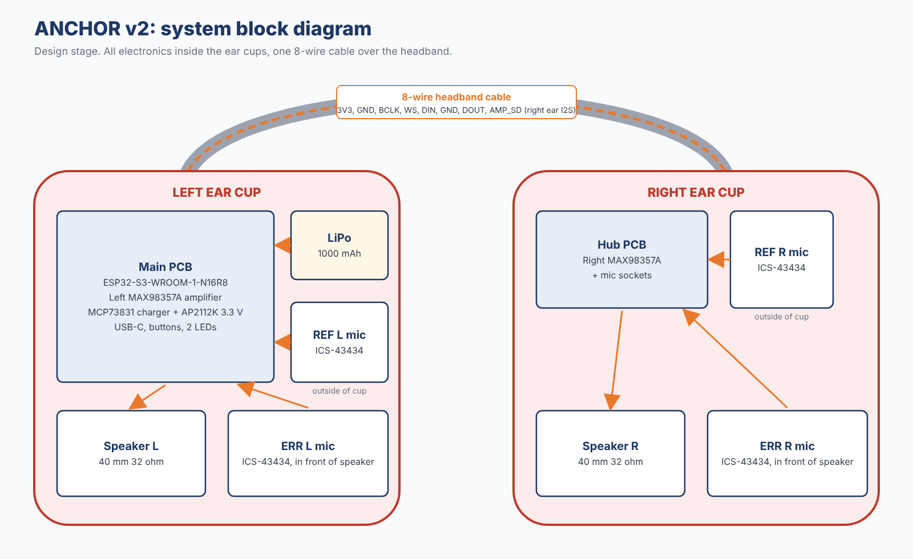
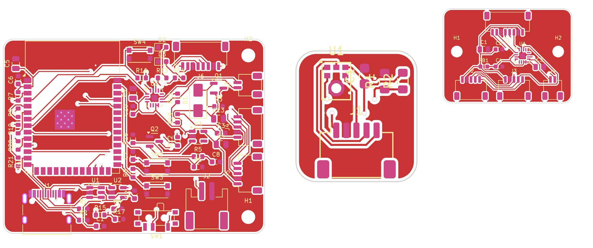
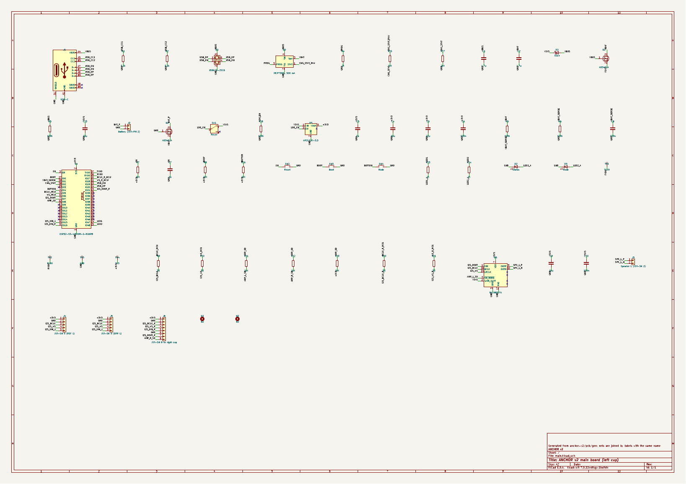
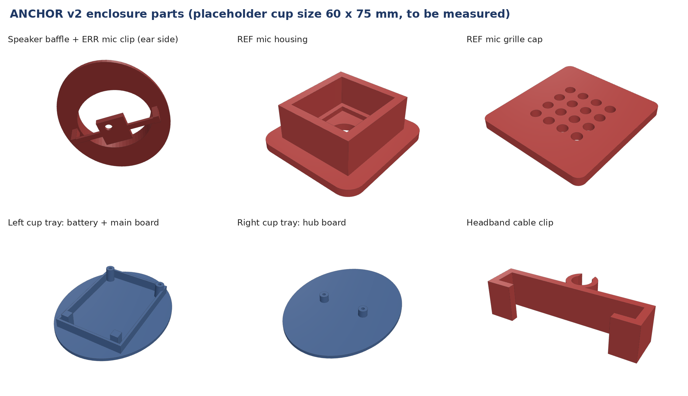

# ANCHOR v2

**A two-ear noise cancelling earmuff for factory and construction workers that cancels machine noise but lets alarms and voices through.**

Status: design stage. v2 has not been built yet.

## What it is

ANCHOR is an industrial earmuff with active noise cancelling and a small on-device sound classifier. Microphones outside each cup hear the machine noise, and an ESP32-S3 plays anti-noise through a speaker inside the cup. When the classifier hears an alarm or a voice, ANCHOR stops cancelling and plays the outside sound into the ear instead.

## Why I'm making it

Earmuffs protect hearing but block everything, including reversing alarms, fire alarms and a supervisor shouting a warning. Many workers take them off to stay aware, which is when hearing gets damaged. Smart hearing protection that solves this exists, but it is expensive and imported. I want a low cost version that a factory in India could actually buy.

I already built a rough v1 (about ₹2,200) for a college design thinking course with my teammates. It proved the idea: noise cancelling works on steady machine hum, and the mic to speaker delay was 3.5 to 4.5 ms. But it was a breadboard with about 30 loose wires on the headband, one ear only, and ran from a power bank. v2 is a proper redesign. See [v1/README.md](v1/README.md).

## What changes in v2

| | v1 (built) | v2 (planned) |
|---|---|---|
| Ears with cancelling | 1 | 2 |
| Electronics | Breadboard on the headband | Custom PCBs inside the cups |
| Wiring | About 30 jumper wires | One 8-wire cable, digital signals only |
| Power | USB power bank | 1000 mAh LiPo, USB-C charging |
| Mic to speaker delay | 3.5 to 4.5 ms (measured) | Under 1 ms (target) |
| Noise reduction | Not measured | Measured with a sound level meter |

## Firmware and AI

v2 keeps the v1 firmware and the trained sound classifier. Each ear is wired exactly like v1 on its own I2S port (left ear on the v1 pins), so v1 sketches run on the left ear unchanged, and [firmware/v2/11_anchor_v2](firmware/v2/11_anchor_v2) runs the v1 cancelling engine in both ears with the same AI. It compiles and links for the ESP32-S3 with both the built-in AI and the Edge Impulse model; it has not run on v2 hardware yet. The ICS-43434 mics have the same -26 dBFS sensitivity and 24-bit I2S format as v1's INMP441, so the training clips still match.

## Design

Full plan: [docs/DESIGN.md](docs/DESIGN.md)

### Wiring

### Schematic and PCB

Three KiCad 7 boards: the main board (51 x 38 mm, left cup), a mic board (12 x 13 mm, four needed) and a right cup hub (30 x 22 mm). Schematics, layouts, Gerbers and JLCPCB BOM and position files are in [pcb/](pcb/).

**Status:** routed and DRC clean (no clearance, unconnected or courtyard errors), but this is a first revision that has **not been reviewed by a second person or built**. See [pcb/README.md](pcb/README.md) for the checks to do before ordering.

### 3D model

Enclosure parts are parametric CadQuery models ([cad/anchor_cad.py](cad/anchor_cad.py)) with STEP files, also imported into [Onshape](https://cad.onshape.com/documents/01ac43861da2c203e8e859be). Cup sizes are placeholders until the earmuff is measured.

## Repo layout

| Folder | Contents |
|---|---|
| `docs/` | Design plan and diagrams |
| `pcb/` | KiCad projects: main board, mic board, right hub |
| `cad/` | Onshape link and exported STEP and STL files |
| `firmware/` | ESP32-S3 Arduino code |
| `v1/` | Photos and notes from the first prototype |

## Credits

v1 was built with my college teammates. I used Claude (an AI assistant) to write this v2 design plan, generate the CAD models and lay out the PCBs. I am reviewing them before anything is ordered.

## Bill of materials

Everything comes in two online orders, delivered: one JLCPCB order (boards fully assembled, chips, and the 3D printed parts) and one Amazon.in order (earmuff, battery, speakers, cables, fixings, tools). Prices are estimates without shipping and will be replaced with the real cart prices before review. Full list with notes: [BOM.csv](BOM.csv).

| Part | Qty | Unit (USD) | Total (USD) | Vendor | Funding |
|---|---|---|---|---|---|
| [PCB fabrication: main, hub, mic boards](https://jlcpcb.com/) | 1 | 10.00 | 10.00 | JLCPCB | Requested |
| [PCB assembly (4 jobs: main, hub, mic REF, mic ERR)](https://jlcpcb.com/) | 1 | 70.00 | 70.00 | JLCPCB | Requested |
| [ESP32-S3-WROOM-1-N16R8 module](https://www.lcsc.com/product-detail/C2913202.html) | 2 | 5.50 | 11.00 | JLCPCB | Requested |
| [MAX98357AETE+T I2S class D amplifier](https://www.lcsc.com/product-image/C910544.html) | 4 | 2.00 | 8.00 | JLCPCB | Requested |
| [ICS-43434 I2S MEMS microphone](https://www.lcsc.com/product-detail/C5656610.html) | 10 | 2.50 | 25.00 | JLCPCB | Requested |
| [MCP73831T-2ACI/OT LiPo charger IC](https://www.lcsc.com/search?q=MCP73831T-2ACI%2FOT) | 2 | 0.60 | 1.20 | JLCPCB | Requested |
| [AP2112K-3.3 LDO regulator](https://www.lcsc.com/search?q=AP2112K-3.3TRG1) | 2 | 0.20 | 0.40 | JLCPCB | Requested |
| [USBLC6-2SC6 USB ESD protection](https://www.lcsc.com/search?q=USBLC6-2SC6) | 2 | 0.20 | 0.40 | JLCPCB | Requested |
| [USB-C 16-pin receptacle](https://www.lcsc.com/search?q=TYPE-C%2016PIN) | 2 | 0.30 | 0.60 | JLCPCB | Requested |
| [AO3401A P-MOSFETs + SS14 Schottky](https://www.lcsc.com/search?q=AO3401A) | 4 | 0.20 | 0.80 | JLCPCB | Requested |
| [JST-SH and JST-PH SMD connectors](https://www.lcsc.com/search?q=SM05B-SRSS-TB) | 28 | 0.15 | 4.20 | JLCPCB | Requested |
| [Passives lot (resistors, capacitors, ferrite bead)](https://www.lcsc.com/search?q=0603%20resistor) | 1 | 4.00 | 4.00 | JLCPCB | Requested |
| [Buttons, slide switch, LEDs](https://www.lcsc.com/search?q=tactile%20switch) | 1 | 2.00 | 2.00 | JLCPCB | Requested |
| [3D printed enclosure parts (JLC3DP, resin)](https://jlc3dp.com/) | 1 | 30.00 | 30.00 | JLCPCB | Requested |
| [Industrial safety earmuff (same model as v1)](https://www.amazon.in/s?k=industrial+safety+earmuff+red) | 1 | 5.00 | 5.00 | Amazon.in | Requested |
| [3.7 V 1000 mAh LiPo (503450) with JST-PH plug](https://www.amazon.in/s?k=3.7v+1000mah+lipo+battery+503450+jst+ph) | 2 | 5.00 | 10.00 | Amazon.in | Requested |
| [40 mm 32 ohm headphone driver](https://www.amazon.in/s?k=40mm+32+ohm+headphone+driver) | 4 | 4.00 | 16.00 | Amazon.in | Requested |
| [JST-SH 1.0 mm double-ended cables (2, 5 and 8 pin)](https://www.amazon.in/s?k=JST+SH+1.0mm+double+ended+cable) | 1 | 8.00 | 8.00 | Amazon.in | Requested |
| [M2 screw assortment](https://www.amazon.in/s?k=M2+screw+assortment+kit) | 1 | 4.00 | 4.00 | Amazon.in | Requested |
| [Acoustic foam sheet](https://www.amazon.in/s?k=acoustic+foam+sheet+thin) | 1 | 4.00 | 4.00 | Amazon.in | Requested |
| [Double-sided foam tape](https://www.amazon.in/s?k=double+sided+foam+tape) | 1 | 3.00 | 3.00 | Amazon.in | Requested |
| [Heat shrink and spiral cable wrap](https://www.amazon.in/s?k=heat+shrink+tube+kit) | 1 | 4.00 | 4.00 | Amazon.in | Requested |
| [UNI-T UT353 sound level meter](https://www.amazon.in/s?k=UNI-T+UT353+sound+level+meter) | 1 | 27.00 | 27.00 | Amazon.in | Requested |
| [Soldering iron kit with multimeter, solder and flux](https://www.amazon.in/s?k=soldering+iron+kit+with+multimeter) | 1 | 27.00 | 27.00 | Amazon.in | Requested |
| **Total** |  |  | **275.60** |  |  |
| **Grant total** |  |  | **275.60** |  |  |
