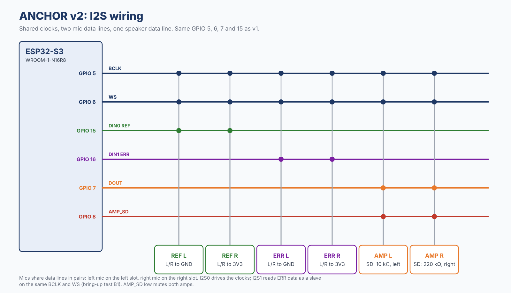

# ANCHOR v2

**A two-ear noise cancelling earmuff for factory and construction workers that cancels machine noise but lets alarms and voices through.**

Status: design stage. v2 has not been built yet.

## What it is

ANCHOR is an industrial earmuff with active noise cancelling and a small on-device sound classifier. Microphones outside each cup hear the machine noise, and an ESP32-S3 plays anti-noise through a speaker inside the cup. When the classifier hears an alarm or a voice, ANCHOR stops cancelling and plays the outside sound into the ear instead.

## Why I'm making it

Earmuffs protect hearing but block everything, including reversing alarms, fire alarms and a supervisor shouting a warning. Many workers take them off to stay aware, which is when hearing gets damaged. Smart hearing protection that solves this exists, but it is expensive and imported. I want a low cost version that a factory in India could actually buy.

I already built a rough v1 (about ₹2,200) for a college design thinking course with my teammates. It proved the idea: noise cancelling works on steady machine hum, and the mic to speaker delay was 3.5 to 4.5 ms. But it was a breadboard with about 30 loose wires on the headband, one ear only, and ran from a power bank. v2 is a proper redesign. See [v1/README.md](v1/README.md).

## What changes in v2

| | v1 (built) | v2 (planned) |
|---|---|---|
| Ears with cancelling | 1 | 2 |
| Electronics | Breadboard on the headband | Custom PCBs inside the cups |
| Wiring | About 30 jumper wires | One 8-wire cable |
| Power | USB power bank | 1000 mAh LiPo, USB-C charging |
| Mic to speaker delay | 3.5 to 4.5 ms (measured) | Under 1 ms (target) |
| Noise reduction | Not measured | Measured with a sound level meter |

## Design

Full plan: [docs/DESIGN.md](docs/DESIGN.md)

### Wiring

### Schematic and PCB

_TODO: add KiCad schematic and PCB screenshots once drawn (files go in [pcb/](pcb/))._

### 3D model

_TODO: add a screenshot of the full Onshape assembly (link goes in [cad/](cad/))._

## Repo layout

| Folder | Contents |
|---|---|
| `docs/` | Design plan and diagrams |
| `pcb/` | KiCad projects: main board, mic board, right hub |
| `cad/` | Onshape link and exported STEP and STL files |
| `firmware/` | ESP32-S3 Arduino code |
| `v1/` | Photos and notes from the first prototype |

## Credits

v1 was built with my college teammates.

## Bill of materials

Prices are estimates and will be replaced with the real cart prices before review. Full list with notes: [BOM.csv](BOM.csv).

| Part | Qty | Unit (USD) | Total (USD) | Vendor | Funding |
|---|---|---|---|---|---|
| [ESP32-S3-WROOM-1-N16R8 module](https://www.lcsc.com/product-detail/C2913202.html) | 2 | 5.50 | 11.00 | LCSC / JLCPCB | Requested |
| [MAX98357AETE+T I2S class D amplifier](https://www.lcsc.com/product-image/C910544.html) | 4 | 2.00 | 8.00 | LCSC / JLCPCB | Requested |
| [ICS-43434 I2S MEMS microphone](https://www.lcsc.com/product-detail/C5656610.html) | 10 | 2.50 | 25.00 | LCSC / JLCPCB | Requested |
| [TP4056 LiPo charger IC](https://www.lcsc.com/search?q=TP4056) | 2 | 0.20 | 0.40 | LCSC / JLCPCB | Requested |
| [AP2112K-3.3 LDO regulator](https://www.lcsc.com/search?q=AP2112K-3.3TRG1) | 2 | 0.20 | 0.40 | LCSC / JLCPCB | Requested |
| [USBLC6-2SC6 USB ESD protection](https://www.lcsc.com/search?q=USBLC6-2SC6) | 2 | 0.20 | 0.40 | LCSC / JLCPCB | Requested |
| [USB-C 16-pin receptacle](https://www.lcsc.com/search?q=TYPE-C%2016PIN) | 2 | 0.30 | 0.60 | LCSC / JLCPCB | Requested |
| [DMG2305UX P-MOSFET + SS14 Schottky (load sharing)](https://www.lcsc.com/search?q=DMG2305UX) | 2 | 0.20 | 0.40 | LCSC / JLCPCB | Requested |
| [JST-SH 5-pin SMD connector](https://www.lcsc.com/search?q=SM05B-SRSS-TB) | 14 | 0.15 | 2.10 | LCSC / JLCPCB | Requested |
| [Passives (resistors, capacitors) lot](https://www.lcsc.com/search?q=0402%20resistor) | 1 | 3.00 | 3.00 | LCSC / JLCPCB | Requested |
| [Buttons, slide switch, LEDs](https://www.lcsc.com/search?q=tactile%20switch) | 1 | 2.00 | 2.00 | LCSC / JLCPCB | Requested |
| [PCB fabrication: main, mic, hub boards (5 each)](https://jlcpcb.com/) | 1 | 8.00 | 8.00 | JLCPCB | Requested |
| [PCB assembly fees (setup, stencil, extended part fees)](https://jlcpcb.com/) | 1 | 35.00 | 35.00 | JLCPCB | Requested |
| [Shipping and import duty to India](https://jlcpcb.com/) | 1 | 25.00 | 25.00 | JLCPCB | Requested |
| [3.7 V 1000 mAh LiPo (KP 503450) with protection](https://www.theengineerstore.in/products/3-7v-1000mah-lithium-polymer-lipo-rechargeable-battery-model-kp-503450) | 2 | 4.00 | 8.00 | The Engineer Store | Requested |
| [40 mm 32 ohm headphone driver](https://www.amazon.in/s?k=40mm+32+ohm+headphone+driver) | 4 | 3.00 | 12.00 | Amazon.in | Requested |
| [8-core thin cable, 1 m](https://www.amazon.in/s?k=8+core+thin+cable) | 1 | 3.00 | 3.00 | Amazon.in | Requested |
| [JST-SH 1.0 mm pre-crimped cable kit](https://www.amazon.in/s?k=JST+SH+1.0mm+pre+crimped+cable) | 1 | 4.00 | 4.00 | Amazon.in | Requested |
| [Industrial earmuff (same model as v1)](https://www.amazon.in/s?k=industrial+safety+earmuff+red) | 1 | 4.00 | 4.00 | Amazon.in | Requested |
| [PETG filament 1 kg](https://www.amazon.in/s?k=PETG+filament+1kg+1.75mm) | 1 | 15.00 | 15.00 | Amazon.in | Requested |
| [UNI-T UT353 sound level meter](https://probots.co.in/ut353-mini-sound-meter-uni-t-audio-noise-decibel-measurement.html) | 1 | 25.00 | 25.00 | Probots | Requested |
| [Heat shrink and spiral cable wrap](https://www.amazon.in/s?k=heat+shrink+tube+kit) | 1 | 3.00 | 3.00 | Amazon.in | Requested |
| Soldering iron, multimeter | 1 | 0.00 | 0.00 |  | Already own |
| **Total** |  |  | **195.30** |  |  |
| **Grant total** |  |  | **195.30** |  |  |
