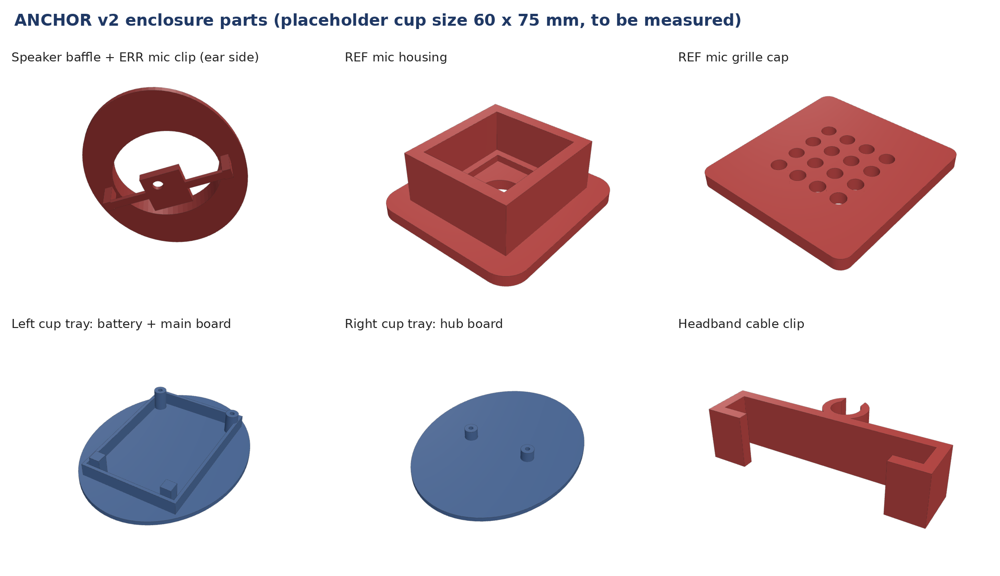

# Enclosure CAD

Parametric parts written in CadQuery: [anchor_cad.py](anchor_cad.py). STEP files (for Onshape, Fusion or any CAD tool) are in [step/](step/), print-ready STL files in [stl/](stl/).

| Part | Qty | What it does |
|---|---|---|
| `speaker_baffle` | 2 | Holds the 40 mm driver in the cup; a bridge holds the ERR mic board 7 mm in front of it, with a hole under the sound port |
| `ref_mic_housing` + `ref_mic_grille_cap` | 2 each | Mounts the REF mic board on the outside of each cup over a cable hole; the cap holds wind foam |
| `left_cup_tray` | 1 | Battery pocket and standoffs for the main board (turned 90 degrees to fit the cup) |
| `right_cup_tray` | 1 | Standoffs for the hub board |
| `headband_cable_clip` | 3 to 4 | Snaps onto the headband and holds the 8-wire cable |

## Placeholder sizes

These values at the top of `anchor_cad.py` are guesses and **must be measured** before printing:

| Parameter | Placeholder | Measure |
|---|---|---|
| `CUP_W`, `CUP_H` | 60 x 75 mm | Inside width and height of the ear cup |
| `DRV_D` | 40.4 mm | Speaker driver diameter + 0.4 mm |
| `BAND_W`, `BAND_T` | 30 x 4 mm | Headband width and thickness |
| `CABLE_D` | 4 mm | 8-core cable diameter |

Change the numbers, run `python anchor_cad.py`, and new STEP and STL files are written to `out/`.

## Onshape

All six parts are imported into this public Onshape document, one Part Studio each: [ANCHOR v2 enclosure](https://cad.onshape.com/documents/01ac43861da2c203e8e859be).

After changing the parameters, re-import the new STEP files with **Create > Import files**.
