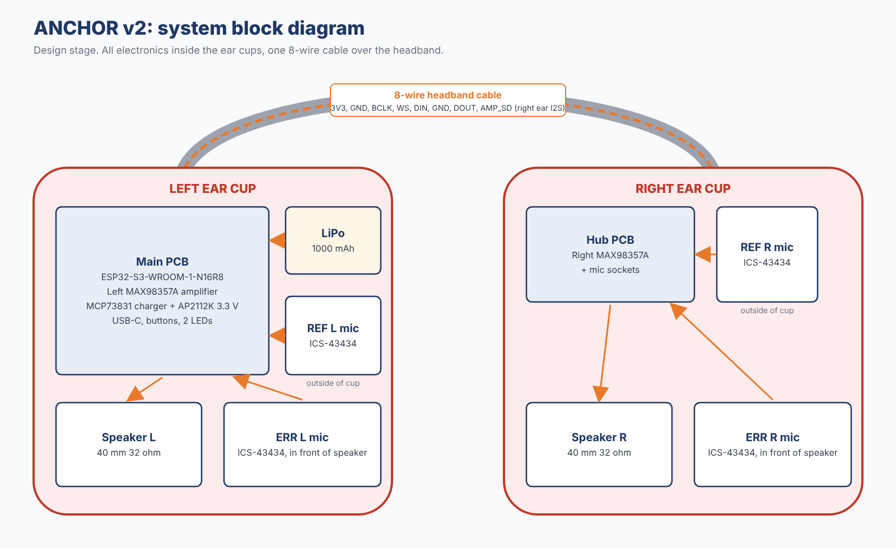
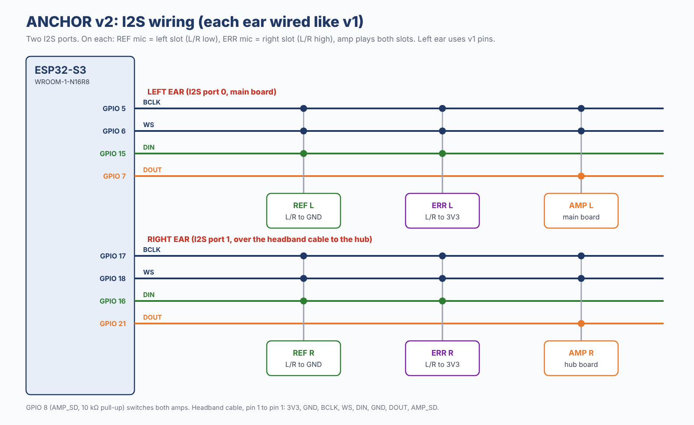

# ANCHOR v2 design plan

ANCHOR is a noise cancelling earmuff for factory and construction workers. It cancels steady machine noise and lets alarms and voices through. v1 was a low cost proof of concept (about ₹2,200) built on a breadboard. This document is the plan for v2: a two-ear build on custom PCBs, with the electronics inside the ear cups and its own battery.

Status: **design stage.** The schematics, PCB layouts ([pcb/](../pcb/)) and enclosure CAD ([cad/](../cad/)) are drawn, but nothing in v2 has been built yet. Each "target" below is a goal to be measured, not a result.

---

## 1. What v1 taught me

| Area | v1 (built) | Problem found |
|---|---|---|
| Ears | One ear cup does ANC (mono) | Only one ear is protected by cancelling |
| Wiring | Breadboard and about 30 jumper wires on the headband | Bulky, connections come loose when the headband flexes |
| Electronics | ESP32-S3 DevKit, INMP441 breakouts, MAX98357A breakout | Boards sit outside the cups |
| Power | USB power bank on a cable | Not wearable for a shift; DevKit 5 V pin read about 0.05 V, so the amp had to run from 3V3 |
| Delay | Mic to speaker delay measured at 3.5 to 4.5 ms | Too slow for anything but steady, repeating hum |
| Cancelling | Works on steady machine hum | Never measured in dB |
| Sound classifier | Four classes: machine, voice, alarm, other | Accuracy on the headset itself was never measured |

## 2. v2 requirements

| # | Requirement | v2 target | How it is checked |
|---|---|---|---|
| R1 | Cancelling in both ears | Two independent FxLMS channels | Test T2 on each ear |
| R2 | Lower delay | Under 1 ms mic to speaker | Test T1, same method as v1 |
| R3 | Measured noise reduction | Report the real number, whatever it is | Test T2 with a sound level meter |
| R4 | Alarms and voices get through | Alarm amplified within 1.5 s in at least 8 of 10 trials | Test T3, T4 |
| R5 | All electronics inside the cups | Nothing on the headband except one cable | Visual check |
| R6 | Runs on its own battery | Full 8 hour shift on one charge | Test T5 |
| R7 | Charges over USB-C | Charges while worn or off | Test T5 |
| R8 | Fails safe | If the electronics stop, it is still a passive earmuff; output level is capped in firmware | Test T6 |
| R9 | Repairable | Mics, speakers and battery on connectors, not soldered to the main board | Visual check |

## 3. System architecture



- **Left cup:** main PCB (ESP32-S3 module, left amplifier, charger, regulator, USB-C, buttons, LEDs), the LiPo battery, left speaker, left REF mic (outside) and left ERR mic (inside).
- **Right cup:** hub PCB with the right amplifier, right speaker, right REF mic and right ERR mic.
- **Headband:** one 8-wire cable between the cups. This replaces the v1 breadboard and jumper wires.

### Signal path (per ear)
1. The REF mic outside the cup hears the machine noise before it reaches the ear.
2. The ESP32-S3 runs FxLMS and makes anti-noise.
3. The amp drives the speaker inside the cup.
4. The ERR mic in front of the speaker hears what is left and the filter adapts.
5. In parallel, a sound classifier listens to the REF mics and switches the mode.

### Mode map (carried over from v1)

| Classifier result | Mode |
|---|---|
| machine or other | Cancel |
| alarm or voice | Hear-through: REF mic sound amplified into the ear |
| quiet | Idle, keep the last filter |
| unsure (under 60% confidence) | Half cancel, half hear-through |
| filter unstable or not calibrated | SAFE: anti-noise muted, passive earmuff only |

## 4. Key part choices

| Function | v1 part | v2 part | Why |
|---|---|---|---|
| Processor | ESP32-S3 DevKitC-1 N16R8 | ESP32-S3-WROOM-1-N16R8 module on my own PCB | Same chip, so v1 firmware ports over; the module is much smaller than the DevKit |
| Microphones | INMP441 breakouts (61 dBA SNR) | ICS-43434 on tiny custom boards (65 dBA SNR) | Lower noise, smaller, same I2S format; 120 dB SPL max input suits loud factories |
| Amplifier | 1 x MAX98357A breakout | 2 x MAX98357A, one in each cup | One per ear; same chip and code as v1. The right one sits on the hub so no speaker current crosses the headband |
| Speakers | 40 mm 8 ohm 0.5 W | 40 mm 32 ohm headphone drivers | Made for a sealed ear cup, better low frequency output where machine hum lives |
| Power | USB power bank | 1000 mAh 1S LiPo, MCP73831 charger (500 mA), AP2112K 3.3 V regulator | Wearable, charges from USB-C |
| Earmuff | Red industrial earmuff (27 dB SNR) | A second earmuff of the same model | Keeps v1 intact so v1 and v2 can be compared side by side |

**Alternative considered:** an audio codec (for example WM8960) with analog mics. It could give lower delay, but it means new drivers and analog layout. I will only switch if I2S digital mics cannot meet R2. Decided after Test T1.

## 5. Delay budget (R2)

v1's delay was mostly buffering: audio was processed in blocks, and each block adds its length to the delay.

| Stage | v2 plan |
|---|---|
| Sample rate | 16 kHz (same as v1; the AI model needs 16 kHz) |
| Block size | 8 samples (0.5 ms per block, same as v1 sketch 09) |
| Input and output buffering | about 3 blocks (1.5 ms) |
| Mic and amp internal filters | to be measured |
| **Target total** | **under 2 ms, measured with v1's delay test** |

Compute check: the v1 cancelling engine does about 800 multiply-adds per sample. Two ears at 16 kHz is about 26 million per second, so each ear gets its own core (left on core 1, right on core 0 with the AI at lower priority). The firmware prints each ear's load every second; Test T1 confirms it.

## 6. Pin map (ESP32-S3-WROOM-1-N16R8)

**Each ear is wired exactly like v1, on its own I2S port.** That way the v1 firmware, the cancelling engine and the trained AI carry over unchanged: on each port the REF mic talks in the left slot (L/R low), the ERR mic in the right slot (L/R high), and the amp plays the same sound on both slots.



| GPIO | Net | Direction | Notes |
|---|---|---|---|
| 5 | LEFT BCLK (I2S0) | out | Same as v1 |
| 6 | LEFT WS (I2S0) | out | Same as v1 |
| 7 | LEFT DOUT (I2S0) | out | Left MAX98357A, same as v1 |
| 15 | LEFT DIN (I2S0) | in | REF L (left slot) + ERR L (right slot), same as v1 |
| 17 | RIGHT BCLK (I2S1) | out | Over the headband cable, 33 Ω series resistor |
| 18 | RIGHT WS (I2S1) | out | Over the headband cable, 33 Ω series resistor |
| 21 | RIGHT DOUT (I2S1) | out | Right MAX98357A on the hub |
| 16 | RIGHT DIN (I2S1) | in | REF R (left slot) + ERR R (right slot) |
| 8 | AMP_SD | out | 10 kΩ pull-up, so both amps are on by default (v1 firmware works); drive low to mute |
| 4 | BUTTON | in | To GND, pull-up |
| 47 | LED_STATUS | out | Through 1 kΩ |
| 48 | LED_MODE | out | Through 1 kΩ |
| 1 | VBAT_SENSE | analog in | 100 kΩ / 100 kΩ divider from battery |
| 2 | CHG_STAT | in | MCP73831 STAT pin through a 10 kΩ / 20 kΩ divider (STAT swings to 5 V) |
| 19, 20 | USB D-, D+ | USB | Native USB, used for flashing and serial |
| 0 | BOOT | in | Boot button to GND |
| EN | RESET | in | Reset button, 10 kΩ pull-up, 1 µF to GND |
| 43, 44 | UART TX, RX | test pads | Backup serial |

**Do not use:** GPIO 26 to 32 (flash), GPIO 33 to 37 (octal PSRAM on the R8 module), and strapping pins 3, 45 and 46.

**Mic boards:** one PCB, two builds. The REF build has R1 fitted (L/R to GND), the ERR build has R2 fitted (L/R to 3.3 V). JLCPCB assembles both, so nothing needs bridging by hand.

**Headband cable (8-pin JST-SH, pin 1 to pin 1):** 1 3V3, 2 GND, 3 RIGHT BCLK, 4 RIGHT WS, 5 RIGHT DIN, 6 GND, 7 RIGHT DOUT, 8 AMP_SD. Only digital signals cross the headband.

## 7. Power design

```
USB-C 5 V ──> MCP73831 charger (RPROG 2 kΩ = 500 mA) ──> LiPo 1000 mAh
   │                                                    │
   └─> SS14 diode ──> VSYS <── AO3401A P-MOSFET <────────┘
                       │      (battery cut off from VSYS while USB is in)
                       ├─> left MAX98357A (shut down by firmware when off)
                       └─> AP2112K-3.3 ──> 3V3: ESP32-S3, 4 mics, right MAX98357A (via ferrite bead)
                              ▲
                       slide switch drives the regulator EN pin only (100 kΩ pull-down = off)
```

- USB-C: 5.1 kΩ resistors on CC1 and CC2, USBLC6-2SC6 ESD protection on D+ and D-.
- Battery with a built-in protection circuit (most 1S LiPo packs have one). Firmware also shuts down at 3.5 V, because the regulator drops out below about that.
- Reverse battery protection: a P-MOSFET (AO3401A, gate to GND) in the battery line, because cheap LiPo packs sometimes come with the plug wired backwards.
- The power switch only pulls the regulator's EN pin high, so it carries almost no current. With the regulator off, the left amp's SD_MODE falls low through its internal pull-down and the amp shuts down.
- Bulk capacitors: 10 µF and 0.1 µF at each amp, 22 µF and 0.1 µF at the module.

**Rough runtime estimate (R6):** ESP32-S3 at 240 MHz with radio off about 60 mA, mics about 2 mA, amps idle about 5 mA plus audio. Around 100 to 120 mA in total gives roughly 8 hours from 1000 mAh. This is a guess until Test T5. If it falls short, the upgrade is a buck-boost regulator (for example TPS63001) to use the whole battery.

## 8. PCBs (KiCad, 2 layers)

| Board | Size target | Qty to order | Contents |
|---|---|---|---|
| Main | 51 x 38 mm, turned 90 degrees in the left cup | 5 made, 2 assembled | ESP32-S3 module, left MAX98357A, MCP73831, AP2112K, USB-C, ESD, reverse battery protection, 3 buttons, power switch, 2 LEDs, connectors |
| Mic | 12 x 13 mm | 10 assembled (8 used, 2 spare) | ICS-43434, 0.1 µF, 5-pin JST-SH, L/R solder jumper (bridge 1-2 left, 2-3 right), sound port hole |
| Right hub | 30 x 22 mm | 5 made, 2 assembled | Right MAX98357A (3.3 V through a ferrite bead), 8-pin JST-SH from the main board, 2 mic sockets, 2-pin speaker socket |

Connectors: mics on 5-pin JST-SH (3V3, GND, BCLK, WS, SD); battery on 2-pin JST-PH; speakers on 2-pin JST-SH; main board to right cup on 8-pin JST-SH.

The 8-wire headband cable carries 3V3, GND, BCLK, WS, REF data, ERR data, speaker data (I2S DOUT) and the right amp's enable. Only digital signals cross the headband: the right amplifier is on the hub, so the class D speaker output (fast switching edges) never runs next to the mic clock and data lines.

Layout rules:
- The ICS-43434 is bottom ported, so each mic board needs a hole under the sound port, sized from the datasheet.
- 33 Ω series resistor on BCLK and WS at the ESP32-S3, because they run about 35 cm to the right cup. Keep a ground wire beside the clock in the cable.
- The radio is not used, so the module's antenna keepout was removed to fit the board. If Wi-Fi or Bluetooth is ever needed, the layout must be redone with the keepout.
- Class D amp outputs short, and away from mic lines.
- Assembly by JLCPCB, because the ICS-43434 LGA package and the MAX98357A TQFN package are hard to hand solder.

## 9. Enclosure and mounting (Onshape, printed in PETG)

Parts to model:
1. **Speaker baffle ring** (x2): holds the 40 mm driver in the cup and has a clip for the ERR mic about 5 to 10 mm in front of the driver centre.
2. **REF mic housing** (x2): mounts on the outside of each cup over a small hole, with foam to block wind.
3. **Left cup tray:** holds the main PCB and the battery behind the speaker baffle, with a USB-C cutout, button cap and LED light pipe.
4. **Right cup tray:** holds the hub board.
5. **Headband cable clips:** keep the cable along the inside of the band.

Measurements to take from the earmuff before modelling: cup inner depth, cup inner width and height, shell thickness, the space behind the foam, and the headband width.

## 10. Firmware plan (Arduino IDE, ESP32 core 3.x)

- **Firmware is written:** [firmware/v2/11_anchor_v2](../firmware/v2/11_anchor_v2). It is sketch 09 with each ear's state in its own `Ear` object, using the same cancelling engine (`anchor_anc2.h`) and AI files unchanged. It compiles and links for the ESP32-S3 with both the built-in AI and the Edge Impulse library.
- **Audio tasks:** left ear on core 1, right ear on core 0, each on its own I2S port, 16 kHz, 8-sample blocks. Output limiter caps the level so the speaker can never get dangerously loud.
- **Start-up calibration:** about 2 seconds of quiet test noise per ear to learn the speaker to ERR mic path. SAFE mode until it passes.
- **Classifier:** listens to the left REF mic, 1 second windows every 0.5 s, same decision rules as v1. Both ears follow its mode request; each ear calibrates and protects itself.
- **Training data:** record clips through the v2 headset's own REF mic over USB, so the model learns from the same mic it will hear in use.
- **Instability guard:** if the ERR mic level rises instead of falling, reset the filter and go to SAFE.
- **Watchdog:** if the audio task stalls, mute the amps. The earmuff still blocks noise passively.

## 11. Bring-up and test plan

### Before ordering PCBs (on the v1 DevKit and parts)
| Test | What | Pass |
|---|---|---|
| B1 | Run sketch 11 on the v1 DevKit with the v1 mics on I2S0 and a second pair on I2S1 (pins 17, 18, 21, 16) | Both ears calibrate, no LOST DATA, load under 70% per core |
| B2 | Run v1 sketch 05 (delay test) on the v2 left ear | Delay at or below v1's 3.5 to 4.5 ms |

### After assembly
| Test | What | Pass |
|---|---|---|
| T1 | Mic to speaker delay, same method as v1 | Under 2 ms |
| T2 | Sound level meter at the ear cup, steady machine hum, cancelling off then on, each ear | Record the dB difference (no fixed pass mark, the number is reported as measured) |
| T3 | Play an alarm 10 times over machine noise | Amplified within 1.5 s in at least 8 of 10 |
| T4 | 10 spoken calls over machine noise | Voice heard clearly in at least 8 of 10 |
| T5 | Full charge, run in cancel mode until shutdown | At least 8 hours |
| T6 | Pull the battery, crash the firmware, block the ERR mic | No loud output; earmuff still blocks noise |

## 12. Timeline

| Week | Work | Output |
|---|---|---|
| 1 | Bring-up tests B1 and B2 on the v1 parts | Proof the two-ear I2S plan works |
| 2 | Main board schematic | KiCad schematic |
| 3 | Mic and hub board schematics and layout; main board layout | KiCad PCBs, DRC clean |
| 4 | Measure the earmuff, model the enclosure parts | Onshape CAD |
| 5 | Order PCBs and parts | Cart and order |
| 6 to 7 | Assembly, firmware port to two ears | Working v2 |
| 8 | Tests T1 to T6, demo video | Results in README |

## 13. Risks

| Risk | Effect | Plan |
|---|---|---|
| Two ears are too much work for the ESP32-S3 | Glitches, LOST DATA | Each ear has its own core; fallback is shorter filters (ANC_NS 192) or cancelling in one ear |
| Delay stays high | Cancelling limited to steady hum | Smaller blocks; fallback is a codec (section 4) |
| Long clock lines to the right cup pick up noise | Clicks, wrong samples | Series resistors, ground beside clock, no analog or speaker signals in the cable |
| Battery life under 8 hours | Not a full shift | Buck-boost regulator, lower clock speed |
| Classifier wrong on the headset | Alarms missed or noise let through | Train on clips recorded through the headset's own mic |
| Hear-through too loud | Harms hearing | Firmware output limiter and gain cap, tested in T6 |
